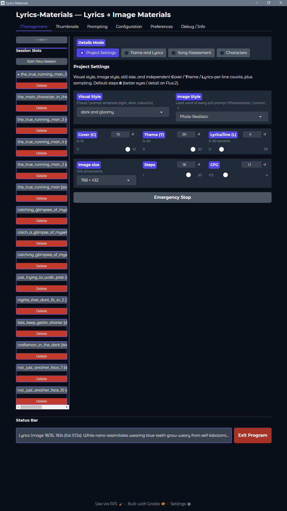
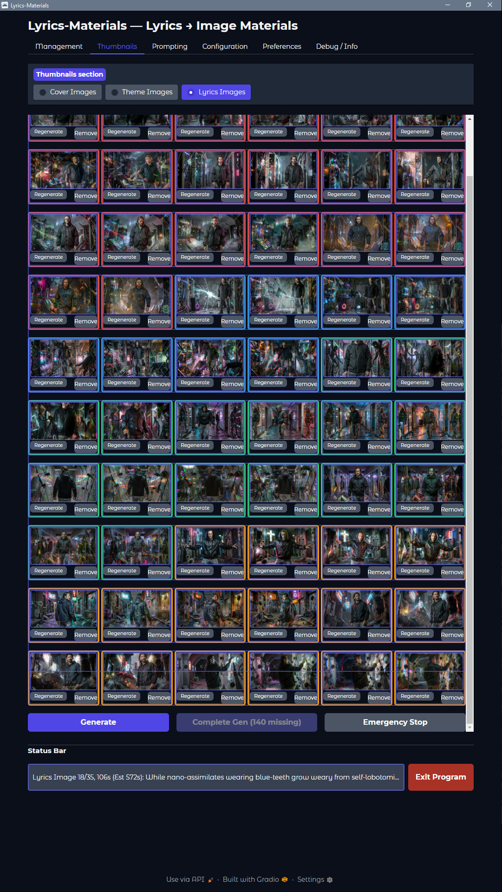
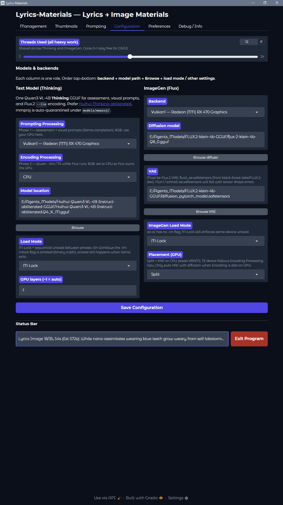

# Lyrics-Materials
Status: Beta - Initial development done, the program seems to work, still some remaining issues, things have been worked on and expanded, and it now supports Flux2 and Ideogram4 models (readme.md still needs updating for ideogram properly).

### Description:
It convert lines of lyrics into AI generated images, up to 30 per line (20 is quite fast enough for me). The idea is one could arrange these in a movie editor, and tactically use theme images for fillers in the video or promotional material, so its a program to make simple AI music videos. One could also take the line of lyrics and the generated images, and feed that into AI video generator to make clips, that could then be assembled into a video clips.

### Media:
- A Music Video on YouTube created with Lyrics-Materials, now, redone and featuring ~4 images per line (v0.43)...
<br>[](https://www.youtube.com/watch?v=AD191Zc3Ies)

- Here is the Management page where the config for the, project and reference character, is setup (v0.47)...


- Here on Thumbnails page, where the user previews generated images and regenerates/completes projects (v0.47)...


- The Configuration page is refined, with two individual models columns allowing optimal setup (v0.25)...


### Features:
- **User Character;** controls for, Reference Image, Gender, Bodyshape, Physical Age 25-95, Hair Style, Outfit Worn.
- **Clever Model Handling;** configure the Encoding processes to, OtherGPU or CPU, to extend Flux2 GPU Memory, while still generating Prompts on GPU too.
- **Local Tool;** not requiring the use of online antigenic services to create your own local model based music slideshows.
- **libraries;** llama.cpp for song analysis + per-line visual prompts, stable-diffusion.cpp for Flux.2-klein. ffmpeg for utility/probe.

### Requirements:
This part of the readme needs completing...
- Windows 10/11.
- Python ~3.12.
- Internet for install of libraries/binaries.
- Grok did an assessment for 8GB VRAM with Qwen3 encoder with CPU and Flux2 model Split...
```
Size,Area vs 768×512,8 GB Split outlook
640 × 360,0.59×,Safe
720 × 405,0.74×,Safe
768 × 432,0.84×,Safe
768 × 512,1.00×,Known-good on your 8 GB
896 × 504,1.15×,Should fit if little else holds VRAM
1024 × 512,1.33×,Marginal — may OOM with driver/fragmentation
1024 × 768,2.00×,Expected crash / OOM (matches what you see)
1280 × 720,2.34×,OOM on 8 GB
1280 × 768,2.50×,OOM
1366 × 768,2.67×,OOM
```
...ask Grok and remember to say, how much vram you have and "Qwen3 encoder on CPU and Flux2 model load Split/Full".

### Models
Available on [HuggingFace.Co](https://huggingface.co/) (the program uses gguf versions of models where possible) (this section needs further updating)...  
1. Generation with Flux2-4b...
- Diffuser: [flux-2-klein-4b-GGUF](https://huggingface.co/models?search=flux2%204b%20gguf) Image generation (one of those, cant remember which one I used) (I used q8).
- VAE: [diffusion_pytorch_model.safetensors](https://huggingface.co/black-forest-labs/FLUX.2-klein-4B/resolve/main/vae/diffusion_pytorch_model.safetensors?download=true) the other image generation file (one file).
- Encoder/Prompting: [Huihui-Qwen3-VL-4B-Thinking-abliterated-GGUF](https://huggingface.co/mradermacher/Huihui-Qwen3-VL-4B-Thinking-abliterated-GGUF) for Rich 
analysis + prompts when set (I used q4). The prompt generation and encoding can be done from the thinking model or the instruct model mode, flux2-Klein-4b requires the 4b version.
2. Generation with IDeogram...

- Encoder/Prompting: [Huihui-Qwen3-VL-8B-Thinking-abliterated-GGUF](https://huggingface.co/mradermacher/Huihui-Qwen3-VL-8B-Thinking-abliterated-GGUF) for Rich 
analysis + prompts when set (I used q4). The prompt generation and encoding can be done from the thinking model or the instruct model model, Ideogram4 requires 8B variants of Qwen3-VL. 
- Diffusion: Ideogram4-Turbo requires the Ideogram4-Turbo gguf file and the flux2-vae, while the uncondit file for Ideogram4 is optional if you can run the whole thing on GPU, because if you select diffuser placement as split on ideogram, its assumed you have low VRAM, so there is no uncond file if diffuser placement is split. This may need improving later, but myself have 8GB VRAM.

### Instructions:
- These are my current instructions for using the program...
```
1. The program will start, you will be in a new project, so collapse the left pane, unless you are going to hop sessions.
2. User enters **song name** (folder slug) and pastes lyrics; optional (advised) single **reference image** for central character.
3. Ensure Image frequency and other settings are correct (and not too wild, see notes), then click "Generate All Assets".
4. When all assets are generated, then click on "Lyrics Thumbnails", have a look at the images, and regenerate them individually as required.
5. When images are all how you intended, then copy them to the movie making app you have. For basic/simple editing, possibly you could use "Microsoft Movie Maker" that came with the "Microsoft Essentials 2012" package.

- As I have repeating stated "for 8GB VRam you would want image settings to, 768x512 or 640x360 (half 720p), that is with Diffuser Placement set to "Split". I would assume one could load the complete Flux2 model to GPU on 12GB card, but then Encoder must be loaded at same time, so possibly still need cpu for Encoder if Full; failure to take consideration may crash or mess up graphics drivers, worse case scenario requiring factory reset install.)
- If you are unsure as to if Flux2 will be ok with your settings and VRam settings, then open Task Manager, there check python process, and monitor GPU memory/shaders. 
- Program designed for Portrait mode monitor, but it should/will work on Landscape too just with some sliders.
- the mmproj from the Qwen3-VL-4B is not used, and if present then is auto-moved to `**model_folder**\mmproj\`, saving complication in the scripts, but the mmproj is superseded by Flux2/Ideogram4.

```
- Lyrics should be in format of (as many chorus as you like)...
```
[Intro]
**intro**

[Chorus 1]
**chorus**

[Chorus 2]
**chorus**

[Chorus 3]
**chorus**

[Outro]
**outro**
```
- If it crashes back to the batch menu, and wont start up because of "port" issues, then try and find python processes and close them, and try again, albeit, give the machine a restart for good measure. This typically happens when more than 1 instance is running. 

### Notation:
- Ideogram4 requires ~850s per image, while flux2 requires ~575s per image on my rx470. On initial tests the ideogram had less likeness to the reference image, so while there will be a video made with ideogram4, the furture of the inclusion of Ideogram is uncertain, given that qwen-image-2.1 integration will begin soon, and its likely I will go with the 2 best, which may end up being, qwen-image-2.1 and flux2, with the way things are going.
- This program was created through converting Image-Glamour, there was extensive testing required to confirm things and craft the prompts, and on top of that there was 2/3 stages of major corruption of prompting for setbacks, but WiseMan-TimeLord, struggled with injuries and endeavored to produce results.
- Got your own lyrics, but do need your own songs to make AI music slideshow videos with Lyrics-Materials, then why not give [Suno](https://suno.com/invite/@wisemantimelord) (its an affiliate link so I get kudos), but its what I typically use, from experience I found basic use to be simple to understand, you yourself can do the singing, while the more you look at the interface and learn it then the more you can find.
- Ensure that the reference image is not HUGE, and I advise trimming it down to, torso and head, or bust and head, then setting the bodyshape correctly. Limiting the reference image to, smaller body area and full head, assists with facial likeness. 
- At 8 Steps per image, most things turn out ok, but at 10 steps the eyes will more likely be correct and not weird looking. At 12 steps, its going to take forever, but I assume the eyes will be 100% correct at that point. 
- Remember by editing `.\scripts\configure.py` script it is possible to have custom hair/clothes/etc. Ie for clothing you would for example search for something unique like "Rocker" in configure script, and then change, prompt detail and relating GUI option, for that one or one of the others you wont use. 
- When a session is under-way, ensure to collapse the session slots column on the left, with the little "--><--" button. This will optimize the interface a little.
- If the Generation page panels relating to Details Mode do not show, try switching back and forth, between Panel Mode's (there are a lot of items to display). 
- This program uses Flux2-4B, if people would prefer a similar program, but that can make motion music videos, then I would need someone to donate enough to get a 16GB GPU, albeit I could also make Lyrics-Materials compatible with Qwen3-8b and Flux2-Klein-8b. No point developing what I cant test/use. 

### Struture:
```
Lyrics-Materials/
├── Lyrics-Materials.bat
├── launcher.py
├── installer.py
├── data/          constants, configs, binaries, ffmpeg, temp
├── scripts/       configure, display, inference, utilities
├── models/
└── output/<song_name>/
        001 - first lyric line.png
        …
        lyrics.txt · analysis.txt · prompts.txt · character_map.txt
```

### Development:
- Ideogram 4 integration, and later on Qwen-Image 2.1 integration, and reverting integration if the model is not capable. This will require additional extended testing if everything is ok.
- Background characters assessment was implemented, and now the sections of the song will have relating assesment consideration to background actors, however I do want option to, have or not have, background actors, IDK songs about being stranded on a desert island.
- Main issue is on switches where panels are iffy, and require switching away, then switching back to get panel contents. This has been worked on already, but needs further work. Before the Thumbnails pages were broken down into individual image types and pages.
- Installer was re-tested, and any issues were fixed for ~0.38, should be ok currently.
- The outfits have been improved, but when other things are done, then this will require further review.
- If there is no reference image, then all of the relating prompting needs to not mention things such as character control traces in positive and negative prompt. This would then be a video featuring no main character in all section assessments, however as are appropriate to do so to the song, would then be featuring background characters (or just groups of people in this case) or not.

### Disclaimer:
- Warnings of quantum-weirdness in advance, but you yourself are the one whom pulls the lever on your own configurations and Lyrics, there is no way I know what your video will turn out like, because it can generate anything; one can always use the Negative prompt to filter out their phobias/fears in a box on the bottom of panel at location of  `Management > Name and Lyrics`.
- Do not over-load your GPU, it could cause graphics driver crash. As stated, ensure you understand the capabilities of your card. My max settings for 8 GB GPU was 768x512 (no bigger), and image models were loaded in Split mode. If your graphics driver does start to crash due to low ram, then try to close the program (python command prompt is fastest) IMMEDIATELY, and re-think your configurations.
